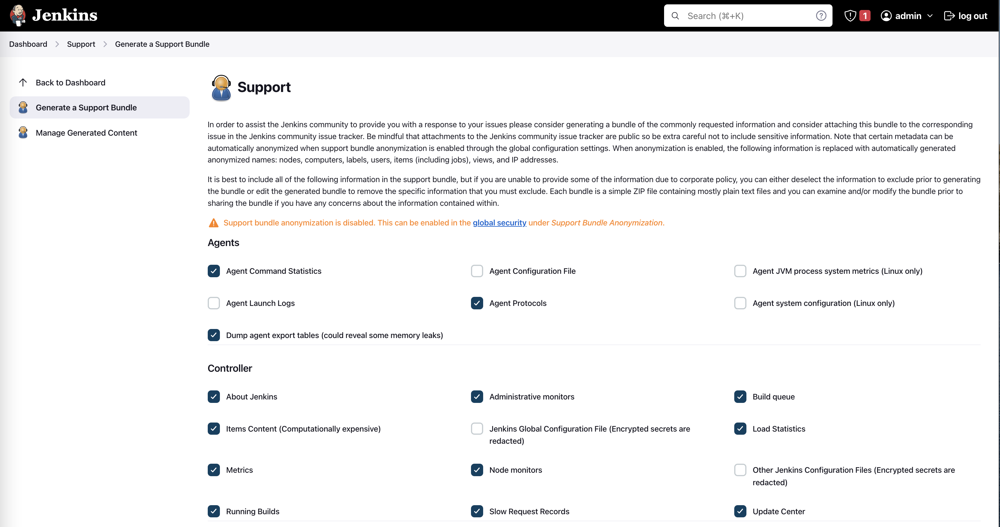

# Support Core Plugin

[](https://ci.jenkins.io/job/Plugins/job/support-core-plugin/job/master/)
[](https://plugins.jenkins.io/support-core)

## Introduction

The plugin provides the basic infrastructure for generating "bundles" of
support information within Jenkins.

There are three ways of generating bundles:

-   Automatic bundles, these get saved in `$JENKINS_HOME/support` once
    per hour starting 3 minutes after Jenkins starts the plugin (i.e.
    this may still be generated even if Jenkins will not fully start).
    The automatic bundles are retained using an exponential aging
    strategy, so you should have a bunch of them over the entire
    lifetime once the plugin has been installed.
-   On demand bundles:
    -   You can generate them from the root "Support" action, using the
        User Interface ; or
    -   By using the CLI Command. For the association documentation,
        please refer to `<yourJenkinsInstanceUrl>/cli/command/support`
        embedded documentation.



## Global Configuration

Features and functionalities of the Support Core plugin can be configured globally 
under **Manage Jenkins > Support Core**. 

### Automated Support Bundle Generation

Configure the automated generation of the Support Bundle. By default, Support Core 
configures a periodic task that generates a support bundle every hour. This can tremendously
help troubleshoot issues in Jenkins, in cases where data could not be collected at the time
an issue happened or started to happen.

The following option apply:

* **Enable**: Whether to enable the automatic generation of the support bundle or not
(default to true)
* **Period**: The recurrence period (in hours) to generate support bundle 
(default to 1h). Values between 1 and 24 are accepted.
* **Components**: The list of components to include in the automatic bundle 
(default to all components)

The system property `com.cloudbees.jenkins.support.SupportPlugin.AUTO_BUNDLE_PERIOD_HOURS` can
be used to enforce the value of the period. Values between 0 and 24 are accepted. A value of `0`
enforce the disablement of the automated support bundle generation. 

### Agent Launch Logs

The plugin maintains a unified log of all agent launch activity at `$JENKINS_HOME/logs/support/agent-launches/all.log`. 
This log preserves launch history even for deleted or ephemeral agents. The log is bounded by size to prevent 
unbounded disk usage.

The following system properties control the agent launch log behavior:

* **`com.cloudbees.jenkins.support.impl.SlaveLaunchLogs.MAX_FILE_SIZE`**: Maximum size in bytes per log file 
  before rotation (default: 2,000,000 = 2 MB). Total disk usage is approximately 
  `MAX_FILE_SIZE × (MAX_ROTATE_LOGS + 1)`.
* **`com.cloudbees.jenkins.support.impl.SlaveLaunchLogs.MAX_ROTATE_LOGS`**: Number of rotated log files to keep 
  (default: 9). With the default settings, up to 10 files (all.log plus all.log.1 through all.log.9) are kept, 
  for a total of approximately 20 MB. Setting this to 0 keeps only all.log, which is truncated on each rotation.
* **`com.cloudbees.jenkins.support.impl.SlaveLaunchLogs.DISABLE_ARCHIVE`**: When set to `true`, disables 
  the unified agent launch log entirely (default: `false`). Individual agent logs in `logs/slaves/<name>/` 
  are unaffected.

**Note:** At startup, any `all.log*` file larger than `MAX_FILE_SIZE` (for example left over by a previous 
version, or by a larger previous setting) is removed.

## Docker File

As part of the support bundle if the About Jenkins option is checked
then you will receive a docker file in the bundle also. The docker file
contains the current version of Jenkins, along with a wget operation to
download all of the plugins on the Jenkins controller. This creates a
similar environment for testing or reproducing bugs.

First build the image:

    docker build -f Dockerfile

then run the docker image

    docker run -d -p 8080:80

This should create a new Jenkins controller with the same version, and the
same plugins and versions all bundled.

## Frequent issues

### Support bundles corrupt through the UI

The most common situation for this to happen is when the **About
Jenkins** option is enabled.

Meanwhile, the support bundle is getting generated it looks like the
generation process is stuck as the downloaded size stays at the same
point for a long time. To diagnosis this issue the best is to take a
threadDump when in the moment where it is stuck and check the Jenkins
logs.

If a stacktrace like the one below appears

```
"Handling POST /support/download from XX.XX.XX.XX : RequestHandlerThread[#126]" Id=123772 Group=main RUNNABLE
    at java.io.UnixFileSystem.getBooleanAttributes0(Native Method)
    at java.io.UnixFileSystem.getBooleanAttributes(UnixFileSystem.java:242)
    at java.io.File.isDirectory(File.java:849)
    at com.cloudbees.jenkins.support.impl.AboutJenkins$ItemsContent.printTo(AboutJenkins.java:641)
    at com.cloudbees.jenkins.support.api.PrintedContent.writeTo(PrintedContent.java:47)
    at com.cloudbees.jenkins.support.SupportPlugin.writeBundle(SupportPlugin.java:359)
    at com.cloudbees.jenkins.support.SupportAction.doDownload(SupportAction.java:154)
```

and the Jenkins logs are populated with 

```
2018-01-04 04:52:17.633+0000 [id=123769] WARNING c.c.j.support.SupportPlugin#writeBundle: Could not attach 'nodes/slave/agent1/checksums.md5' to support bundle
org.eclipse.jetty.io.EofException: Closed
    at org.eclipse.jetty.server.HttpOutput.write(HttpOutput.java:476)
    at net.bull.javamelody.FilterServletOutputStream.write(FilterServletOutputStream.java:88)
    at net.bull.javamelody.CounterResponseStream.write(CounterResponseStream.java:82)
    at org.apache.tools.zip.ZipOutputStream.writeOut(ZipOutputStream.java:1029)
    at org.apache.tools.zip.ZipOutputStream.deflate(ZipOutputStream.java:680)
    at org.apache.tools.zip.ZipOutputStream.closeEntry(ZipOutputStream.java:432)
    at org.apache.tools.zip.ZipOutputStream.putNextEntry(ZipOutputStream.java:489)
    at com.cloudbees.jenkins.support.SupportPlugin.writeBundle(SupportPlugin.java:358)
    at com.cloudbees.jenkins.support.SupportAction.doDownload(SupportAction.java:154)
```

Then, surely the problem is that you are hitting the **Idle timeout** in
the load balancer and this makes the connection betweek the ELB and your
broweser to drop. To workaround this problem you can:

-   Increase the Idle timeout in the load balancer
-   Not include About Jenkins section
-   Reduce the number of builds in the system

## Support Bundle Anonymization

[Beginning in version
2.48](https://issues.jenkins-ci.org/browse/JENKINS-21670),
this plugin now allows for automated `ContentFilter` extensions to
enable anonymizing of various data. By enabling this feature, the
default set of filters will anonymize agent names, agent computer names,
agent labels, view names (aka folders), job names, usernames, and IP
addresses (both IPv4 and IPv6). These data are mapped to randomly
generated fake names which are saved to Jenkins controller. A Jenkins
administrator can view these mappings by going to **Manage Jenkins** **›>
Support Bundle Anonymization**. All files written to the support bundle
by this and all extensions of this plugin will replace all instances of
the original values with their anonymized counterpart. Note that the
Stop Words list on that page shows which terms are ignored when
filtering names (case-insensitive full match).

### Additional Stop Words

Additional Stop Words can be provided in a text file located at 
`$JENKINS_HOME/support/additional-stop-words.txt`. Each non-blank line of
the file is treated as a stop word. The following contains 3 stop words `abc`,
`john doe` and `https://test.example.com`

```
abc
john doe
https://test.example.com
```

The system property `com.cloudbees.jenkins.support.filter.ContentMappings.additionalStopWordsFile`
can be used to override the file location.

### Limitations

Anonymization filters only apply to text files. It cannot handle
non-Jenkins URLs, custom proprietary Jenkins plugin names, and
exceptions quoting invalid Groovy code in a Jenkins pipeline. The active
plugins, disabled plugins, failed plugins, and `Dockerfile` reports are
not anonymized due to several Jenkins plugins and other Java libraries
using version numbers that are indistinguishable from IP addresses.
These reports are in the
files `plugins/active.txt`, `plugins/disabled.txt`, `plugins/failed.txt`,
and `docker/Dockerfile`. These files should all be manually reviewed if
you do not wish to disclose the names of custom proprietary plugins.

## <a name="casc"></a>Configuration as Code

As of 2.68 version, support-core is compatible with [Jenkins Configuration as Code](https://github.com/jenkinsci/configuration-as-code-plugin) (CasC).

The configuration looks like:

```
security:
  anonymizeSupportBundle:
    enabled: true
```
It enables (_true_) or disables (_false_) the anonymization of the bundle.

Previous versions of this plugin could be configured by CasC as well, but the configuration was so:

```
unclassified:
  contentFilters:
    enabled: false
```
This version changes the configuration fields to be more intuitive. Please update your yaml file if
you update support-core to version 2.68 or later.


## Support Bundle - Sensitive data auto redaction
Starting from version 2.72.2, Support Core plugin could automatically redact any passwords stored in the following files:
* `nodes.md`
* `about.md`
* `nodes/master/system.properties` for controllers and agents
* `nodes/master/environment.txt`
* `nodes/slave/name/proc/self/environ` and `nodes/slave/name/proc/self/cmdline` for Linux based instances
* `nodes/slave/name/config.xml` for each agent
* launch log files per each agent located in `nodes/slave/name/launchLogs`

To support this feature, a text file named `security-stop-words.txt` has been added to the `$JENKINS_HOME/support` folder. It contains security stop words that are used to detect passwords or secrets. When the bundle is generated, the word "REDACTED" replaces any values associated with these stop words.

For example, if one of the security stop words is "passwd", the following string:
````
-username.net.passwd=mySecret
````
will be changed to:
````
-username.net.passwd=REDACTED
````
To disable this feature, delete all of the security stop words from the security-stop-words.txt file (but not the file itself, because it will be automatically regenerated with a default values). Any changes made to the security-stop-words.txt file are applied after a Jenkins instance restart.

## Changelog

### Version 2.71 and newer

See [GitHub releases](https://github.com/jenkinsci/support-core-plugin/releases).

### Version 2.70 (2020 Aug 13) and older

See the [historical changelog](https://github.com/jenkinsci/support-core-plugin/blob/c7ad7403086db6929627fcfd4287b2c7ea3026a3/CHANGELOG.md).
